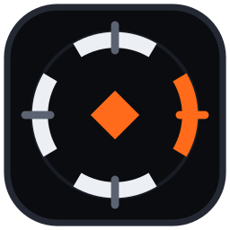
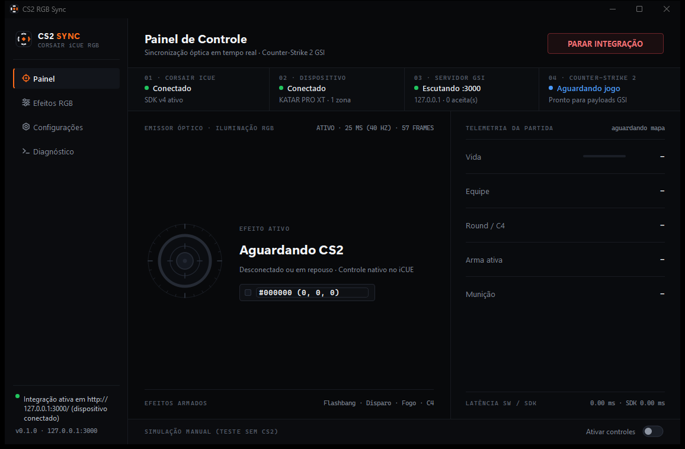
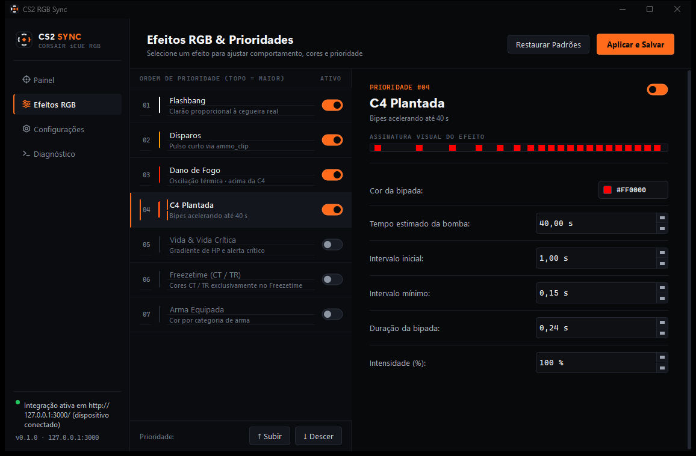
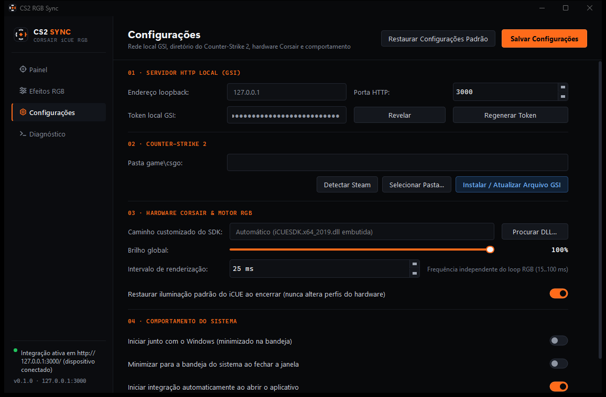
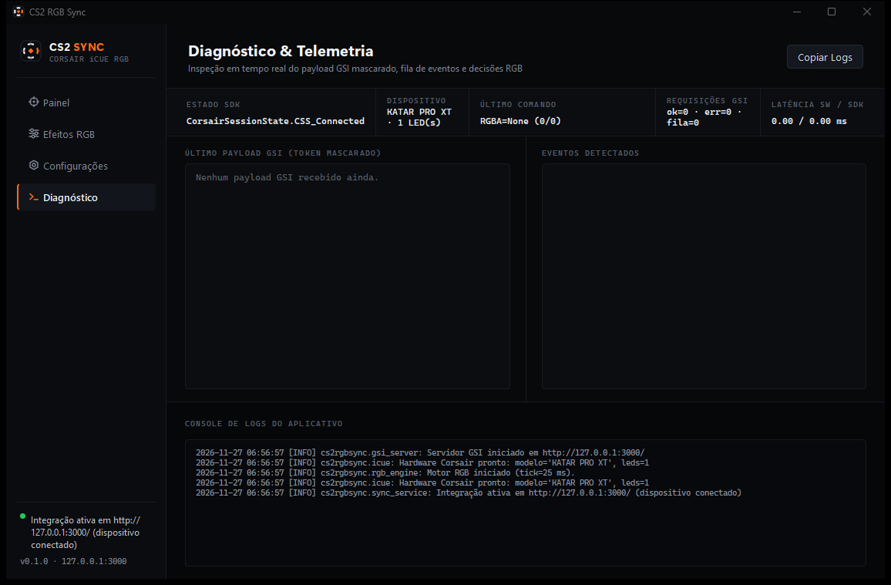

<div align="center">
  
  <h1>CS2 RGB Sync</h1>
  <p><strong>Real-time Counter-Strike 2 Game State Integration RGB synchronization for compatible Corsair iCUE devices on Windows 11.</strong></p>
  <p>
    <strong>English</strong> &nbsp;|&nbsp; <a href="README.pt-BR.md">Português (Brasil)</a>
  </p>
  <p>
    <code>Obsidian Calibre UI</code> &nbsp;·&nbsp; <code>Valve CS2 GSI (127.0.0.1)</code> &nbsp;·&nbsp; <code>Corsair iCUE SDK v4</code> &nbsp;·&nbsp; <code>Status: 0.1.0 Pre-Release Preparation</code>
  </p>
</div>

---

## 1. Project Overview

**CS2 RGB Sync** is a free, local desktop application for **Windows 11 (64-bit)** that synchronizes RGB lighting on compatible **Corsair** devices in real time with in-game events from **Counter-Strike 2 (CS2)**.

It connects Counter-Strike 2's official **Game State Integration (GSI)** HTTP push feed on loopback (`127.0.0.1`) with an independent priority-driven animation engine (`RGBEngine`) and the **Corsair iCUE SDK v4**, driving reactive combat and objective effects without reading game memory, injecting DLLs, or modifying hardware profiles, DPI, macros, or keybinds.

---

## 2. Key Features

- **100% Local Execution:** Binds strictly to `127.0.0.1` (`ConfigManager` rejects non-loopback hosts). No cloud servers, external accounts, telemetry, or paid APIs.
- **Official CS2 GSI Push Pipeline:** Automatically locates Steam libraries (`libraryfolders.vdf` + Windows Registry) and installs only `gamestate_integration_cs2rgbsync.cfg` into `game\csgo\cfg\`.
- **Dynamic Corsair Device Discovery:** Enumerates Corsair devices through the iCUE SDK (`CorsairDeviceType.CDT_All`) and reads addressable RGB LEDs dynamically via `get_led_positions(device_id)` (or filters via an optional `hardware.target_model` preference).
- **8 Configurable Effects with Priority Resolution:** Flashbang, Weapon Shot, Fire Damage, C4 Planted, Critical Health, Health Gradient, Team Freezetime (CT/TR), and Active Weapon Category.
- **Freezetime-Scoped Team Colors:** Custom CT and TR colors trigger exclusively during CS2 **Freezetime** (using `round.phase` and `phase_countdowns.phase`) and clear immediately when the round becomes live.
- **Obsidian Calibre Desktop GUI (PySide6):** Dashboard with optical emitter preview and live telemetry, Effects editor with priority reordering, Settings panel, Diagnostics view with token redaction (`***REDACTED***`), Built-in Simulator, and Windows system tray integration.
- **Non-Destructive Lighting Handback:** Releases SDK lighting control (`alpha = 0` + `release_control`) when CS2 is in menus, disconnected, or when stopping/exiting the app so your normal iCUE profile resumes immediately.

---

## 3. Screenshots

Captured directly from the compiled Windows executable (`CS2RGBSync.exe`, **Obsidian Calibre** UI + **Optical Reticle** mark, no personal paths or live tokens):

| Control Dashboard (`Painel`) | RGB Effects Studio (`Efeitos RGB`) |
| :---: | :---: |
|  |  |

| Local & Hardware Settings (`Configurações`) | Live Diagnostics & Logs (`Diagnóstico`) |
| :---: | :---: |
|  |  |

---

## 4. Compatibility & Requirements

- **Operating System:** Windows 11 (64-bit)
- **Game:** Counter-Strike 2 installed via Steam
- **RGB Software:** [Corsair iCUE](https://www.corsair.com/icue) (iCUE 5 recommended) running with **SDK enabled** (*Settings -> SDK*)
- **Hardware:** A Corsair RGB device recognized by iCUE that exposes controllable RGB LEDs via the iCUE SDK
- **Visual C++ Runtime (Windows):** Microsoft Visual C++ Redistributable (x64, VS 2019+) as required by `cuesdk` / `iCUESDK.x64_2019.dll`
- **From Source Only:** Python 3.12 (64-bit) + packages in [`requirements.txt`](requirements.txt)

---

## 5. Supported Hardware

CS2 RGB Sync is developed specifically for **Corsair hardware compatible with the Corsair iCUE SDK v4**. It is **not** a universal RGB controller.

> **Compatibility depends on the device capabilities exposed by the Corsair iCUE SDK. Not every Corsair product or RGB device is necessarily supported.**

### Hardware Verification Status

| Category | Status | Details |
| -------- | ------ | ------- |
| **Corsair Katar Pro XT** | **Detected & Functionally Verified** | Physically tested with iCUE SDK v4 (`1` RGB zone, `LUID 0x00040001`), Flashbang, Shot, Fire, C4, Idle off, and iCUE handback |
| **Other Corsair RGB Devices (keyboards, mice, headsets, mousepads, coolers, RAM, controllers)** | **SDK Discovery Implemented / Physically Unverified** | `ICueController` queries `CorsairDeviceType.CDT_All` and selects the first device with valid `get_led_positions(device_id)` (or matching `target_model`); individual models have not yet been physically bench-tested in this project |
| **Non-Corsair Brands (Razer, Logitech, SteelSeries, HyperX, OpenRGB, etc.)** | **Not Supported** | No integration for third-party or generic HID RGB protocols is implemented |

Important hardware notes:
- Having physical RGB LEDs on a Corsair product does not guarantee those LEDs are exposed or controllable through the iCUE SDK.
- Detecting a device model string in iCUE does not equate to full functional verification across all lighting zones or firmware revisions.
- Currently, `ICueController` drives **one selected target device per session** (choosing the configured `hardware.target_model` if found, or the first detected Corsair device reporting LEDs via SDK). Simultaneous multi-device lighting synchronization is **not** implemented yet.

---

## 6. Installation

> Detailed step-by-step instructions are also available in [`docs/INSTALLATION.md`](docs/INSTALLATION.md).

### Option A: Windows Installer (`CS2RGBSync_Setup.exe`)

1. Download `CS2RGBSync_Setup.exe` from the local `release-artifacts/` directory (or a future official GitHub Release).
2. Run the installer and select optional tasks (Desktop shortcut, Windows startup with `--minimized`, automatic CS2 GSI setup).
3. If GSI auto-setup is enabled, confirm the detected Steam/CS2 folder (`...\Counter-Strike Global Offensive\game\csgo`) or browse to it manually.
4. Launch **CS2 RGB Sync**.

### Option B: Portable Archive (`CS2RGBSync_Portable.zip`)

1. Extract the **entire** ZIP archive preserving the `CS2RGBSync\` directory structure (`CS2RGBSync.exe` alongside `_internal\`). Do not move `CS2RGBSync.exe` out of its folder.
2. Launch `CS2RGBSync.exe` (no Python installation required).
3. Go to **Configurações** (*Settings*) -> **Detectar** (or **Selecionar Pasta...**) -> **Instalar / Atualizar Arquivo GSI**.

### Option C: Run from Source

```powershell
py -3.12 -m venv .venv
.\.venv\Scripts\Activate.ps1
python -m pip install -r requirements.txt
python main.py
```

---

## 7. First-Time Setup

1. Open **Corsair iCUE**, go to **Settings -> SDK**, and enable **iCUE SDK / Game & Application Integrations**.
2. Open **CS2 RGB Sync**.
3. On **Configurações** (*Settings*):
   - Verify or select your Counter-Strike 2 folder (`...\game\csgo`).
   - Click **Instalar / Atualizar Arquivo GSI** to write `gamestate_integration_cs2rgbsync.cfg`.
4. Return to **Painel** (*Dashboard*) and verify **Corsair iCUE** and your detected Corsair device appear ready.
5. Click **INICIAR INTEGRAÇÃO**.
6. Launch Counter-Strike 2 (if CS2 was already open when writing the `.cfg`, restart CS2 once so it reloads GSI configurations).

---

## 8. Counter-Strike 2 Game State Integration

CS2 RGB Sync generates and manages only one file inside CS2:

`<SteamLibrary>\steamapps\common\Counter-Strike Global Offensive\game\csgo\cfg\gamestate_integration_cs2rgbsync.cfg`

Default GSI parameters configured in `app/gsi_config.py` and `gsi/gamestate_integration_cs2rgbsync.cfg`:

- `uri`: `http://127.0.0.1:<port>/` (default `3000`)
- `timeout`: `5.00`
- `buffer`: `0.05`
- `throttle`: `0.05`
- `heartbeat`: `15.0`
- `auth.token`: Local auto-generated secret shared only between `config.json` and the local `.cfg`
- Subscribed `data` blocks:
  - `provider` `"1"`
  - `map` `"1"`
  - `round` `"1"`
  - `phase_countdowns` `"1"`
  - `player_id` `"1"`
  - `player_state` `"1"`
  - `player_weapons` `"1"`
  - `player_match_stats` `"1"`

> Spectator-only `allplayers_*` and `bomb` subscriptions are **not** included. No pre-existing CS2 `.cfg` files (such as `autoexec.cfg` or third-party `gamestate_integration_*.cfg` files) are modified or deleted.

---

## 9. Corsair iCUE SDK Integration

Implemented in [`app/icue_controller.py`](app/icue_controller.py) using `cuesdk==4.0.84` and `iCUESDK.x64_2019.dll`:

- All SDK calls are serialized through `threading.RLock()`.
- `connect()` establishes an iCUE session, subscribes to `CEI_DeviceConnectionStatusChangedEvent`, calls `get_devices(CorsairDeviceFilter(CDT_All))`, and inspects `get_led_positions(device_id)` to enumerate LED zones dynamically.
- `hardware.target_model` defaults to `""` (auto-selects the first Corsair device exposing RGB LEDs; if a model substring is provided, matching models are tried first with fallback to other detected devices).
- Applies LED colors at configurable `layer_priority` (`200` default) without altering hardware DPI, polling rate, buttons, macros, or saved device profiles.
- Safe teardown sequence (`restore_default()`, `CorsairUnsubscribeFromEvents()`, `CorsairDisconnect()`) releases control cleanly back to iCUE.

---

## 10. RGB Effects

Only the **8 effects** implemented in [`app/effects.py`](app/effects.py) and configured in [`config/default_config.json`](config/default_config.json) exist in this codebase:

| Effect ID | Default Enabled | Trigger Condition in Code | Visual Behavior & Key Parameters |
| --------- | --------------- | ------------------------- | -------------------------------- |
| `flashbang` | `true` | `snapshot.is_local_player` and `flashed > 0` (handles both CS2 binary `0 -> 1 -> 0` and continuous `0..255` / `0.0..1.0` scales) | Immediate white replacement scaled proportionally by flash level with peak retention and smooth decay (`color: #FFFFFF`, `fade_tail_ms: 220`, `binary_fade_ms: 650`, `intensity: 100`) |
| `shot` | `true` | Active firearm `ammo_clip` decreases between snapshots (guarded against reloads, weapon switches, non-firearms, and spectating) | Crisp pulse burst (`color: #FF9900`, `duration_ms: 50`, `debounce_ms: 40`, `intensity: 100`) |
| `fire` | `true` | `burning > 0` (`player.state.burning` reported in real GSI payloads) | Rapid thermal oscillation between primary/secondary flame colors (`color_primary: #FF2200`, `color_secondary: #FF9900`, `oscillation_hz: 4.0`, `intensity: 100`) |
| `c4` | `true` | `round.bomb == "planted"` | Accelerating red warning pulses across configurable `bomb_timer_s: 40.0` (`color: #FF0000`, `initial_interval_s: 1.0`, `min_interval_s: 0.15`, `beep_duration_s: 0.24`, `intensity: 100`). Note: For live players, CS2 GSI reports `"planted"` without exact seconds remaining, so countdown pacing uses elapsed plant time in software |
| `health_critical` | `false` *(uses `health.enabled`)* | `0 < health < critical_threshold` (`25` default) | Urgent red pulse (`color_critical: #FF0000`, `critical_pulse_hz: 2.5`, `intensity: 100`) |
| `health` | `false` | `health >= critical_threshold` (yields to `team_round` only when `effects.team.enabled` is active during Freezetime) | Smooth color gradient across `100` (`#00FF00`), `75` (`#80FF00`), `50` (`#FFFF00`), and `25` (`#FF9900`) HP (`intensity: 100`) |
| `team_round` | `false` *(via `effects.team`)* | **Exclusively** when `snapshot.is_freezetime` is `True` and `team` is `CT` or `T` | Applies `ct_color` (`#008CFF`) or `t_color` (`#FF9900`) — pulsing smoothly if `freezetime_pulse: true` (`freezetime_pulse_hz: 0.8`) or solid if `false`. Automatically returns `None` during `live`, `over`, `warmup`, `bomb`, `defuse`, or menus |
| `weapon` | `false` | Active weapon category (`knife`, `pistol`, `rifle`, `sniper`, `smg`, `shotgun`, `grenade`) | Steady category color (`intensity: 100`) |

When in a live match and no enabled effect is active, `RGBEngine` keeps the device LEDs off (`(0, 0, 0)`) instead of retaining stale effect colors. When disconnected or in the CS2 main menu, control returns to iCUE.

---

## 11. Effect Priority System

Every `tick_ms` (`25 ms` default = `40 Hz`), `resolve_active_effect()` in [`app/effects.py`](app/effects.py) evaluates enabled effects from highest priority to lowest using `config["priorities"]`:

```text
flashbang > shot > fire > c4 > health_critical > health > team_round > weapon
```

1. **Flashbang** overrides everything immediately when blinded.
2. **Shot** overrides sustained objective/status lighting for a brief burst window (`50 ms` default).
3. **Fire** overrides **C4** so standing in Molotov/incendiary fire remains visible even while C4 is planted.
4. **C4** remains active between shots/fire while planted.
5. **Critical Health** & **Health** activate only if enabled manually.
6. **Team Freezetime (CT / TR)** illuminates only during `is_freezetime` if enabled manually.
7. **Active Weapon** acts as lowest-priority baseline only if enabled manually.

Priority order can be customized in **Efeitos RGB** (*Subir* / *Descer*).

---

## 12. Architecture Overview

```text
Counter-Strike 2
  │  Official Game State Integration (HTTP POST JSON)
  ▼
Local HTTP Server (127.0.0.1:<port>)   [app/gsi_server.py · Flask/Werkzeug · auth token check]
  │  Non-blocking thread-safe queue (drops oldest on burst)
  ▼
Event Parser                           [app/gsi_parser.py · partial merge · previously/added · is_freezetime]
  │  Immutable GameStateSnapshot
  ▼
Event Manager                          [app/event_manager.py · shot delta + anti-reload/spectator · round/bomb transitions]
  │  Typed GameEvent list
  ▼
RGB Engine (25 ms independent loop)    [app/rgb_engine.py + app/effects.py · priority resolution · fade/smoothing]
  │  Deduplicated RGBA frame
  ▼
Corsair iCUE SDK Controller            [app/icue_controller.py · cuesdk · RLock · CDT_All · get_led_positions]
  │  Native SDK calls (iCUESDK.x64_2019.dll)
  ▼
Compatible Corsair RGB Device
```

Decoupling guarantee: HTTP POST handlers enqueue payloads and return `200 OK` immediately without touching the iCUE SDK. `RGBEngine` renders asynchronously in its own daemon thread, while `SyncService` ([`app/sync_service.py`](app/sync_service.py)) acts as a thread-safe facade for the PySide6 UI ([`ui/`](ui/)).

---

## 13. Security, Privacy, Compatibility & Fair Play

### Code-Audited Guarantees (What CS2 RGB Sync Does NOT Do)

Based on a source and dependency audit of [`main.py`](main.py), [`app/`](app/), and [`ui/`](ui/):

- Does **not** inject DLLs into Counter-Strike 2.
- Does **not** open CS2 process handles or call `ReadProcessMemory` / `WriteProcessMemory`.
- Does **not** install function hooks, detours, or kernel drivers.
- Does **not** modify Counter-Strike 2 executables, PAK/VPK game files, or network packets.
- Does **not** automate movement, aim, shooting, buys, macros, or gameplay inputs.
- Does **not** attempt to bypass VAC or any anti-cheat system.
- Does **not** read Steam login credentials or Steam account data. (CS2 GSI optionally includes the local Steam64 ID inside CS2's own `provider`/`player` JSON solely so `GSIParser` can detect `provider.steamid == player.steamid` to distinguish playing vs. spectating.)
- Does **not** make outbound internet connections or send gameplay data to remote servers. Verified via code search: the only HTTP client call in runtime code is loopback `http://127.0.0.1:<port>/` inside `main.py --self-check`.

### Security, Privacy & Local Data

- **Loopback-Only Listener:** `ConfigManager` and `GSIServer` enforce `127.0.0.1` binding (`server.host` cannot be changed to `0.0.0.0` or external IPs).
- **Configurable Port:** `1024..65535` (default `3000`).
- **Local Shared Token:** `server.token` is randomly generated locally via `secrets.token_urlsafe(24)`. It only authenticates local HTTP POSTs from CS2 GSI and is **not** a Steam credential. Tokens are redacted (`***REDACTED***`) in logs and Diagnostics payload previews (`app/logger.py`, `app/gsi_server.py`).
- **Local Storage:** Settings and logs are stored strictly on disk at `%LOCALAPPDATA%\CS2RGBSync\config.json` and `%LOCALAPPDATA%\CS2RGBSync\logs\cs2rgbsync.log` (max 2 MB x 3 rotating backups).
- **How to Erase Local Data:** Exit the app via system tray **Sair**, delete `%LOCALAPPDATA%\CS2RGBSync\`, and remove `gamestate_integration_cs2rgbsync.cfg` from `...\game\csgo\cfg\`.
- **Permissions:** Normal execution requires standard Windows user permissions only. Windows Installer setup defaults to `%ProgramFiles%\CS2 RGB Sync` (standard Windows UAC prompt during install/uninstall); running the Portable ZIP requires no administrator elevation.

### Compatibility Notice

> "Compatibility depends on the device capabilities exposed by the Corsair iCUE SDK. Not every Corsair product or RGB device is necessarily supported."

### Fair Play & Disclaimer

CS2 RGB Sync uses Valve's official, game-provided **Game State Integration** output rather than inspecting or modifying the CS2 client process, keeping game telemetry parsing completely separate from peripheral lighting logic. CS2 RGB Sync contains no gameplay automation or cheat functionality.

**Important:** CS2 RGB Sync is an independent community software project and is **not** affiliated with, endorsed by, or certified by **Valve Corporation** or **Corsair Memory, Inc.** No third-party tool can guarantee immunity against future third-party anti-cheat policy changes; use at your own discretion.

### Official References

- Valve Developer Community — Counter-Strike Game State Integration: <https://developer.valvesoftware.com/wiki/Counter-Strike:_Global_Offensive_Game_State_Integration>
- Corsair Official iCUE SDK (C/C++): <https://github.com/CorsairOfficial/cue-sdk>
- Corsair Official `cue-sdk-python` (`cuesdk` wrapper): <https://github.com/CorsairOfficial/cue-sdk-python>
- Corsair iCUE Software Download: <https://www.corsair.com/icue>
- Qt / PySide6 Licensing: <https://www.qt.io/licensing/>
- Flask Documentation: <https://flask.palletsprojects.com/>

---

## 14. Technology Stack

- **Language:** Python 3.12 (64-bit)
- **Desktop GUI:** PySide6 6.12.0 (`QtWidgets`, `QtGui`, `QtCore`)
- **Local GSI HTTP Server:** Flask 3.1.3 + Werkzeug 3.1.9
- **Hardware Integration:** `cuesdk==4.0.84` (`iCUESDK.x64_2019.dll`)
- **System Process Inspection:** `psutil` 7.2.2
- **Testing:** `pytest` 9.2.0
- **Packaging:** PyInstaller 6.22.3 + Inno Setup 6

---

## 15. Project Structure

```text
CS2 RGB Sync/
├── app/                         # Core backend (config, GSI server/parser, events, effects, engine, iCUE)
├── ui/                          # PySide6 GUI (Obsidian Calibre theme, Optical Reticle icons, 4 pages + tray)
├── config/
│   └── default_config.json      # Factory defaults (target_model="", HE absent)
├── gsi/
│   └── gamestate_integration_cs2rgbsync.cfg  # Token-free GSI reference template
├── assets/icons/                # Official Optical Reticle assets (.svg, .png, .ico)
├── docs/
│   ├── INSTALLATION.md
│   ├── CONFIGURATION.md
│   ├── TROUBLESHOOTING.md
│   └── assets/                  # GitHub README logo, icon, and live app screenshots
├── installer/
│   └── CS2RGBSync.iss           # Inno Setup 6 Windows installer script
├── tests/                       # Automated unit, integration, Freezetime & offscreen UI tests (50 tests)
├── tools/                       # Icon/manual PDF generators, GSI probe & legacy hardware test scripts
├── config.example.json          # Safe anonymized user config template
├── CS2RGBSync.spec              # PyInstaller onedir build spec
├── CS2RGBSync_onefile.spec      # PyInstaller onefile reference spec
├── build.bat                    # Automated full build script
├── requirements.txt             # Python dependencies
├── THIRD_PARTY_LICENSES.txt     # Third-party dependency & Corsair SDK notices
├── SECURITY.md                  # Vulnerability reporting & token privacy policy
├── CONTRIBUTING.md              # Contributor setup & engineering guidelines
├── CHANGELOG.md                 # Verified change log
├── LICENSE                      # MIT License (Copyright (c) 2026 Tales Souza)
├── README.md                    # Documentation (English)
└── README.pt-BR.md              # Documentation (Português do Brasil)
```

---

## 16. Configuration

See [`config.example.json`](config.example.json) for the full schema and [`docs/CONFIGURATION.md`](docs/CONFIGURATION.md) for parameter details (including brightness scaling, C4 timer pacing, custom colors, Freezetime pulse frequency, and Windows autostart).

---

## 17. Troubleshooting

Common issues (iCUE SDK disabled, CS2 not sending GSI, port 3000 conflict, Freezetime toggle disabled by default, system tray close behavior) are documented in [`docs/TROUBLESHOOTING.md`](docs/TROUBLESHOOTING.md).

---

## 18. Frequently Asked Questions

### Security & Fair Play

- **Is CS2 RGB Sync a cheat?**
  No. It is a passive peripheral RGB visualizer that reacts strictly to local GSI state notifications and does not interact with gameplay inputs or game internals.
- **Does it inject DLLs into Counter-Strike 2?**
  No. Audited source code confirms zero DLL injection or remote thread creation.
- **Does it modify game memory?**
  No. It never opens the CS2 process or calls `ReadProcessMemory` / `WriteProcessMemory`.
- **Can it interfere with VAC?**
  It uses Valve's official GSI HTTP feed designed for third-party integrations rather than touching CS2 memory or files. While GSI is an official Valve mechanism, no third-party application can make an absolute legal/anti-cheat guarantee.
- **Does it read my Steam account information?**
  No. It does not access Steam login files or Steam credentials. It only reads Steam library folder paths (`libraryfolders.vdf` + standard Windows Steam registry path) to locate CS2's `cfg` directory, and compares SteamIDs inside local GSI payloads to ignore spectator views.
- **Does it send my gameplay data to external servers?**
  No. All GSI reception (`127.0.0.1`), logging, and rendering stay strictly local on your Windows machine.
- **Does it modify Counter-Strike 2 files?**
  It creates/updates only `gamestate_integration_cs2rgbsync.cfg` inside `...\game\csgo\cfg\`. No CS2 binaries, maps, or user `.cfg` files are altered.
- **Does it require administrator privileges?**
  Not at runtime. The portable build runs purely as a standard user; only the optional system-wide installer writes to `Program Files` via standard Windows elevation.
- **How does Game State Integration work?**
  You place a `gamestate_integration_*.cfg` file inside `game\csgo\cfg\`. CS2 acts as an HTTP client pushing JSON state snapshots (`map`, `round`, `phase_countdowns`, `player`) to your local listener at `http://127.0.0.1:<port>/`.
- **Is the application officially affiliated with Valve or Corsair?**
  No. It is an independent project using publicly documented APIs/SDKs from Valve and Corsair.

### Hardware & Compatibility

- **Which devices are supported?**
  Corsair peripherals/components recognized by Corsair iCUE that expose addressable RGB LEDs via the Corsair iCUE SDK v4.
- **Does it work with any RGB device?**
  No. Only compatible Corsair devices accessible through Corsair iCUE SDK v4 are supported.
- **Does it support devices from other brands?**
  No. Non-Corsair hardware is not supported by the current implementation.
- **Do I need Corsair iCUE installed?**
  Yes. Corsair iCUE must be installed, running in the background, and have **SDK** enabled in iCUE settings.
- **Does every Corsair RGB device work?**
  Not guaranteed. *"Compatibility depends on the device capabilities exposed by the Corsair iCUE SDK. Not every Corsair product or RGB device is necessarily supported."*
- **Why is my device not appearing?**
  Verify iCUE is running, **Settings -> SDK** is enabled, your device appears in iCUE's home screen, and `hardware.target_model` in `config.json` is empty (`""`) unless intentionally filtering a specific model. Inspect **Diagnóstico** for SDK error details.
- **Can I use multiple compatible Corsair devices?**
  Not simultaneously in the current version. `ICueController` discovers all compatible devices (`CDT_All`) and drives one selected device exposing RGB LEDs per session.
- **Do all devices support the same RGB effects?**
  Effects send uniform RGBA color updates across all `led_ids` reported by `get_led_positions(device_id)` for the active device. Physical visual impact depends on the number, brightness, and layout of LEDs exposed by your specific Corsair model.

---

## 19. Releases & Versioning

This repository is currently at **`0.1.0` (Pre-Release / Release Candidate local preparation)**. No public GitHub tag or Release has been published yet.

---

## 20. Roadmap

There is currently no formal public roadmap committed beyond stabilizing pre-release builds and documenting community feedback on additional Corsair device models exposed via iCUE SDK.

---

## 21. Contributing

Contributions, bug reports, and device compatibility observations are welcome! See [`CONTRIBUTING.md`](CONTRIBUTING.md) for environment setup, testing (`pytest -v`), and security guidelines.

---

## 22. Credits & Third-Party Notices

See [`THIRD_PARTY_LICENSES.txt`](THIRD_PARTY_LICENSES.txt) for bundled component notices:
- **Python 3.12** (PSF-2.0)
- **PySide6 / Shiboken6** (LGPL-3.0-only)
- **Flask, Werkzeug, Jinja2, Click, ItsDangerous, MarkupSafe** (BSD-3-Clause), **blinker** (MIT)
- **psutil** (BSD-3-Clause)
- **cue-sdk-python (`cuesdk`)** (MIT wrapper by Corsair Memory, Inc.)
- **Corsair iCUE SDK (`iCUESDK.x64_2019.dll`)** — **Proprietary component** of Corsair Memory, Inc., governed by Corsair's official iCUE SDK terms (separate from the MIT wrapper license and distinct from any open-source project license).

---

## 23. License

The original source code of **CS2 RGB Sync** is licensed under the **MIT License** — see [`LICENSE`](LICENSE) (`Copyright (c) 2026 Tales Souza`).

> **Third-Party Scope Clarification:** The MIT License applies **solely** to the original source code of CS2 RGB Sync and does **not** grant MIT rights over third-party or proprietary components bundled in binary releases, such as `PySide6` / `Qt6` (`LGPL-3.0-only`) or Corsair's proprietary `iCUESDK.x64_2019.dll` (governed by Corsair's official iCUE SDK terms). See [`THIRD_PARTY_LICENSES.txt`](THIRD_PARTY_LICENSES.txt) for details.
