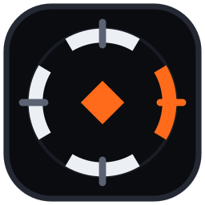
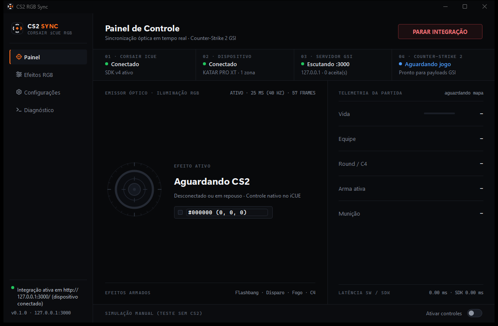
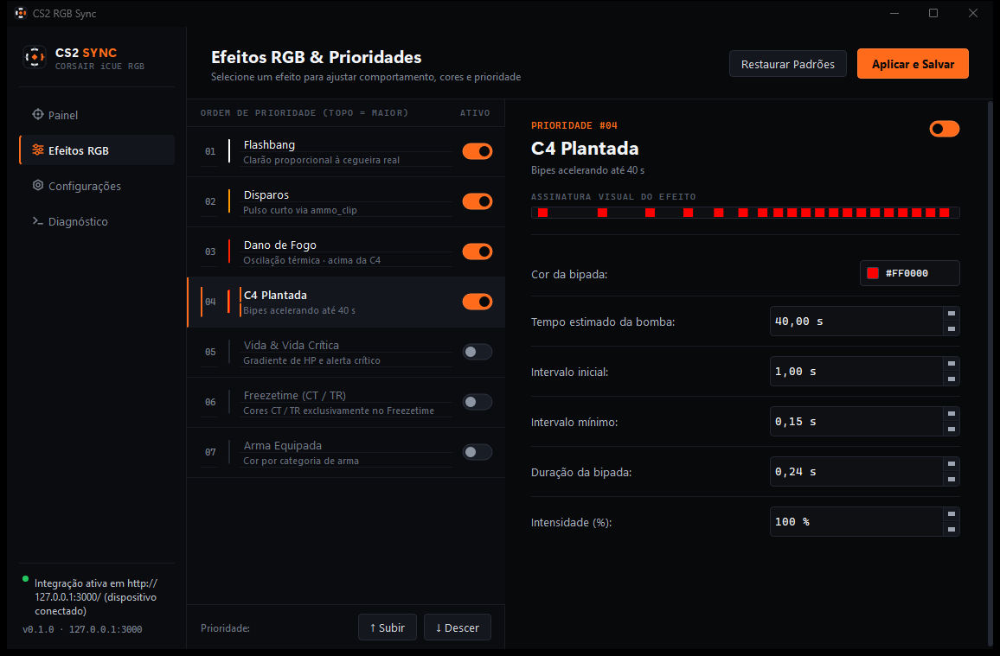
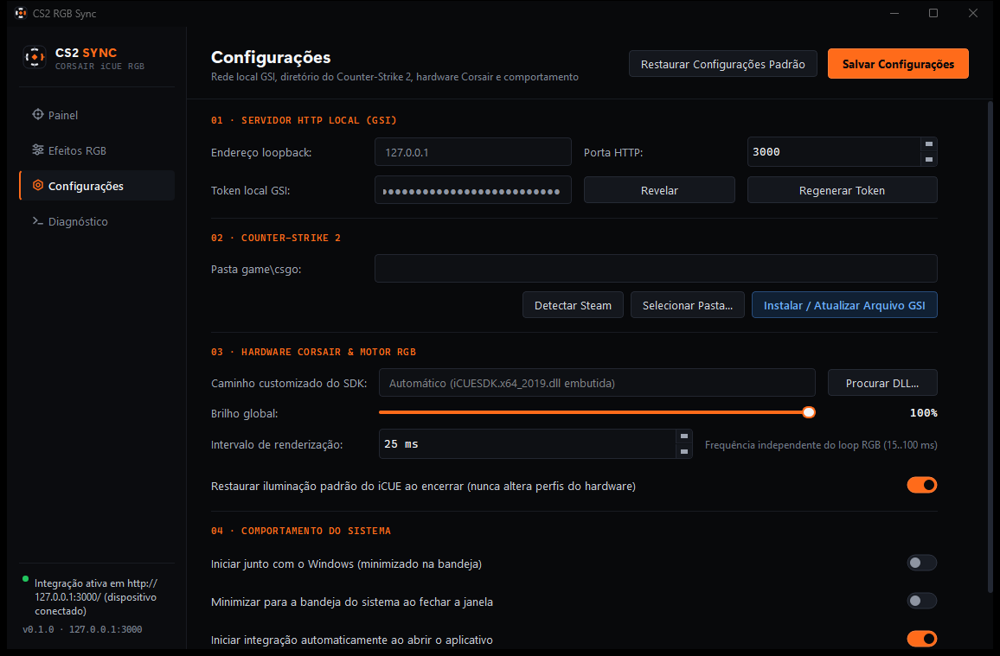
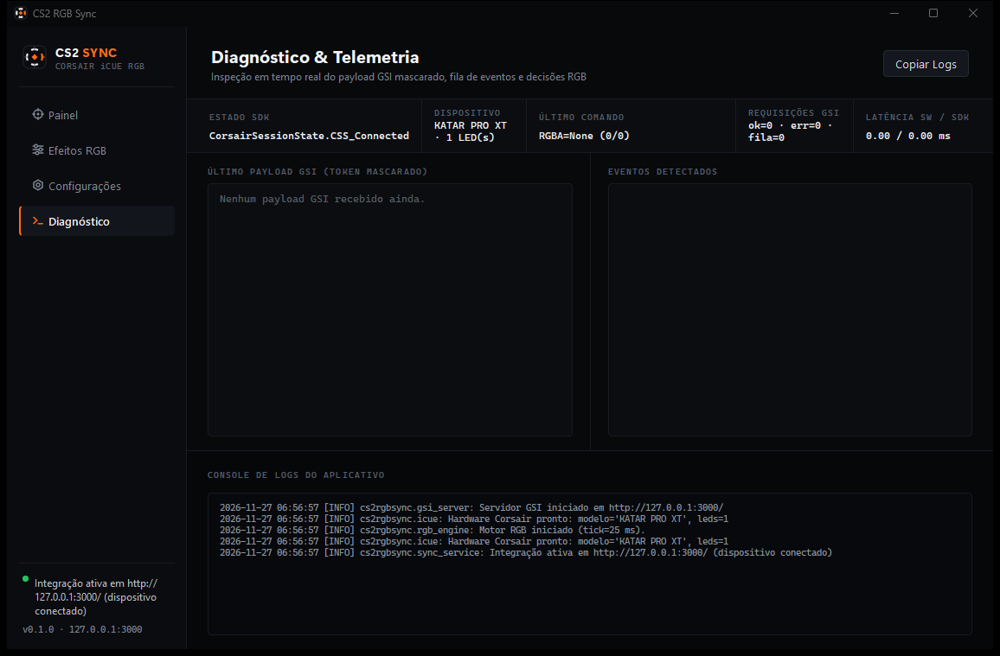

<div align="center">
  
  <h1>CS2 RGB Sync</h1>
  <p><strong>Sincronização RGB em tempo real com eventos do Counter-Strike 2 Game State Integration para dispositivos Corsair compatíveis com o iCUE SDK no Windows 11.</strong></p>
  <p>
    <a href="README.md">English</a> &nbsp;|&nbsp; <strong>Português (Brasil)</strong>
  </p>
  <p>
    <code>Interface Obsidian Calibre</code> &nbsp;·&nbsp; <code>Valve CS2 GSI (127.0.0.1)</code> &nbsp;·&nbsp; <code>Corsair iCUE SDK v4</code> &nbsp;·&nbsp; <code>Status: 0.1.0 Pré-Lançamento</code>
  </p>
</div>

---

## 1. Visão Geral do Projeto

O **CS2 RGB Sync** é um aplicativo desktop local e gratuito para **Windows 11 (64 bits)** que sincroniza em tempo real a iluminação RGB de dispositivos **Corsair** compatíveis com acontecimentos de uma partida de **Counter-Strike 2 (CS2)**.

Ele integra a API oficial **Game State Integration (GSI)** do CS2 em loopback (`127.0.0.1`) a um motor de prioridades independente (`RGBEngine`) e ao **Corsair iCUE SDK v4**, entregando efeitos reativos sem leitura de memória, sem injeção de DLLs e sem alterar DPI, perfis internos, macros ou botões no iCUE.

---

## 2. Principais Recursos

- **Execução 100% Local:** Escuta estritamente em `127.0.0.1` (`ConfigManager` rejeita qualquer host externo). Sem servidores em nuvem, contas externas, telemetria ou APIs pagas.
- **Integração GSI Oficial:** Localiza bibliotecas Steam automaticamente (`libraryfolders.vdf` + Registro do Windows) e grava apenas `gamestate_integration_cs2rgbsync.cfg` em `game\csgo\cfg\`.
- **Descoberta Dinâmica via iCUE SDK:** Consulta dispositivos Corsair via `CorsairDeviceType.CDT_All` e lê zonas/LEDs dinamicamente com `get_led_positions(device_id)` (ou prioriza `hardware.target_model` quando preenchido).
- **8 Efeitos Configuráveis com Hierarquia de Prioridade:** Flashbang, Disparo, Dano de Fogo, C4 Plantada, Vida Crítica, Gradiente de Vida, Freezetime por Equipe (CT/TR) e Arma Equipada.
- **Cores CT / TR Exclusivas no Freezetime:** As cores personalizadas de equipe acendem exclusivamente durante o **Freezetime** (usando `round.phase` e `phase_countdowns.phase`) e apagam imediatamente ao iniciar a rodada.
- **Interface Obsidian Calibre (PySide6):** Painel de controle com emissor óptico genérico e telemetria ao vivo, editor de Efeitos RGB, Configurações, Diagnóstico com mascaramento automático de segredos (`***REDACTED***`), Modo de Simulação interno e bandeja do sistema.
- **Devolução Limpa ao iCUE:** Devolve o controle de iluminação (`alpha = 0` + `release_control`) ao encerrar, parar a integração, desconectar ou entrar no menu do CS2.

---

## 3. Capturas de Tela

Capturadas diretamente do executável Windows recompilado (`CS2RGBSync.exe`, identidade **Obsidian Calibre** + marca **Optical Reticle**, sem caminhos pessoais ou tokens reais):

| Painel de Controle (`Painel`) | Estúdio de Efeitos (`Efeitos RGB`) |
| :---: | :---: |
|  |  |

| Configurações Locais e Hardware (`Configurações`) | Diagnóstico e Logs (`Diagnóstico`) |
| :---: | :---: |
|  |  |

---

## 4. Compatibilidade e Requisitos

- **Sistema Operacional:** Windows 11 (64 bits)
- **Jogo:** Counter-Strike 2 instalado via Steam
- **Software RGB:** [Corsair iCUE](https://www.corsair.com/icue) (iCUE 5 recomendado) em execução com **SDK ativado** (*Configurações -> SDK*)
- **Hardware:** Dispositivo Corsair RGB reconhecido pelo iCUE que exponha zonas/LEDs controláveis pelo iCUE SDK
- **Runtime Windows:** Microsoft Visual C++ Redistributable (x64, VS 2019+) exigido pelo `cuesdk` / `iCUESDK.x64_2019.dll`
- **Execução via código-fonte:** Python 3.12 (64 bits) + dependências em [`requirements.txt`](requirements.txt)

---

## 5. Hardware Suportado

O CS2 RGB Sync é desenvolvido exclusivamente para **dispositivos Corsair compatíveis com o Corsair iCUE SDK v4**. Ele **não** é um controlador RGB universal.

> **Compatibility depends on the device capabilities exposed by the Corsair iCUE SDK. Not every Corsair product or RGB device is necessarily supported.**
> *(A compatibilidade depende dos recursos expostos pelo Corsair iCUE SDK para cada dispositivo. Nem todo produto Corsair ou periférico RGB é necessariamente compatível.)*

### Status de Verificação de Hardware

| Categoria | Status | Detalhes |
| --------- | ------ | -------- |
| **Corsair Katar Pro XT** | **Detectado e Testado Funcionalmente** | Validado fisicamente com iCUE SDK v4 (`1` zona RGB, `LUID 0x00040001`), Flashbang, Disparo, Fogo, C4, repouso apagado e devolução ao iCUE |
| **Outros Dispositivos Corsair RGB (teclados, mouses, headsets, mousepads, coolers, memórias, controladoras)** | **Descoberta SDK Implementada / Ainda Não Verificados Fisicamente** | O `ICueController` consulta `CorsairDeviceType.CDT_All` e seleciona o primeiro dispositivo com `get_led_positions(device_id)` válido (ou que corresponda a `target_model`); outros modelos não passaram por teste físico individual |
| **Outras Marcas (Razer, Logitech, SteelSeries, HyperX, OpenRGB etc.)** | **Não Suportado** | Nenhuma integração com protocolos de outras marcas foi implementada |

Observações importantes:
- Possuir iluminação RGB física não garante que o modelo exponha zonas controláveis pelo iCUE SDK.
- Detectar um dispositivo não equivale a um teste funcional completo em todas as zonas LED ou firmwares.
- Na implementação atual, `ICueController` controla **um dispositivo selecionado por sessão** (priorizando `hardware.target_model` se configurado, ou o primeiro dispositivo Corsair que retornar LEDs pelo SDK). Controle simultâneo de múltiplos dispositivos não está implementado.

---

## 6. Instalação

> Instruções detalhadas também estão disponíveis em [`docs/INSTALLATION.md`](docs/INSTALLATION.md).

### Opção A: Instalador Windows (`CS2RGBSync_Setup.exe`)

1. Baixe `CS2RGBSync_Setup.exe` em `release-artifacts/` (ou em uma futura Release oficial do GitHub).
2. Execute o instalador e selecione as opções desejadas (atalho na Área de Trabalho, iniciar com o Windows em `--minimized`, configuração automática do GSI).
3. Se a configuração GSI estiver marcada, confirme a pasta detectada do CS2 (`...\Counter-Strike Global Offensive\game\csgo`) ou selecione-a manualmente.
4. Conclua a instalação e abra o **CS2 RGB Sync**.

### Opção B: Versão Portátil (`CS2RGBSync_Portable.zip`)

1. Extraia o arquivo ZIP **completo** preservando a estrutura da pasta `CS2RGBSync\` (`CS2RGBSync.exe` ao lado de `_internal\`). Não separe o `.exe` da pasta `_internal`.
2. Execute `CS2RGBSync.exe` (não exige Python instalado).
3. Acesse **Configurações** -> **Detectar** (ou **Selecionar Pasta...**) -> **Instalar / Atualizar Arquivo GSI**.

### Opção C: Execução pelo Código-Fonte

```powershell
py -3.12 -m venv .venv
.\.venv\Scripts\Activate.ps1
python -m pip install -r requirements.txt
python main.py
```

---

## 7. Configuração Inicial

1. No **Corsair iCUE**, abra **Configurações -> SDK** e ative a opção de **SDK do iCUE / Integrações de jogos e aplicativos**.
2. Abra o **CS2 RGB Sync**.
3. Em **Configurações**:
   - Confira ou selecione a pasta do Counter-Strike 2 (`...\game\csgo`).
   - Clique em **Instalar / Atualizar Arquivo GSI** para criar `gamestate_integration_cs2rgbsync.cfg`.
4. No **Painel**, confirme que **Corsair iCUE** e seu dispositivo Corsair aparecem conectados.
5. Clique em **INICIAR INTEGRAÇÃO**.
6. Abra o Counter-Strike 2 (caso o jogo já estivesse aberto ao gravar o `.cfg`, reinicie o CS2 uma vez).

---

## 8. Game State Integration do Counter-Strike 2

O CS2 RGB Sync gerencia exclusivamente um único arquivo no diretório do CS2:

`<BibliotecaSteam>\steamapps\common\Counter-Strike Global Offensive\game\csgo\cfg\gamestate_integration_cs2rgbsync.cfg`

Parâmetros definidos em `app/gsi_config.py` e `gsi/gamestate_integration_cs2rgbsync.cfg`:

- `uri`: `http://127.0.0.1:<porta>/` (`3000` padrão)
- `timeout`: `5.00`, `buffer`: `0.05`, `throttle`: `0.05`, `heartbeat`: `15.0`
- `auth.token`: segredo local gerado automaticamente apenas entre `config.json` e o `.cfg`
- Blocos `data` assinados: `provider`, `map`, `round`, `phase_countdowns`, `player_id`, `player_state`, `player_weapons`, `player_match_stats`.

> Blocos de espectador (`allplayers_*` e `bomb`) **não** são solicitados. Nenhum outro arquivo `.cfg` do CS2 é alterado ou removido.

---

## 9. Integração com o Corsair iCUE SDK

Implementada em [`app/icue_controller.py`](app/icue_controller.py) via `cuesdk==4.0.84` e `iCUESDK.x64_2019.dll`:

- Serialização completa por `threading.RLock()`.
- `connect()` conecta ao iCUE SDK, escuta eventos `CEI_DeviceConnectionStatusChangedEvent`, enumera `CorsairDeviceType.CDT_All` e consulta `get_led_positions(device_id)` dinamicamente.
- `hardware.target_model` vem vazio (`""`) por padrão (seleção automática do primeiro dispositivo compatível com LEDs RGB; se preenchido, prioriza o modelo correspondente com fallback).
- Opera em camada de iluminação (`layer_priority: 200`) sem alterar DPI, polling rate, botões, macros ou perfis internos do hardware.
- Desconexão segura com `restore_default()`, `CorsairUnsubscribeFromEvents()` e `CorsairDisconnect()`.

---

## 10. Efeitos RGB

Estes são os **8 únicos efeitos** implementados em [`app/effects.py`](app/effects.py) e configuráveis em [`config/default_config.json`](config/default_config.json):

| ID do Efeito | Padrão | Condição de Ativação no Código | Comportamento Visual e Parâmetros |
| ------------ | ------ | ------------------------------ | --------------------------------- |
| `flashbang` | `true` | `snapshot.is_local_player` e `flashed > 0` (escala binária `0 -> 1 -> 0` e contínua `0..255` / `0.0..1.0`) | Substituição imediata por branco proporcional à cegueira com retenção de pico e decaimento suave (`#FFFFFF`, `fade_tail_ms: 220`, `binary_fade_ms: 650`, `intensity: 100`) |
| `shot` | `true` | Redução de `ammo_clip` em arma de fogo ativa (protegido contra recarga, troca de arma e modo espectador) | Pulso curto no disparo (`#FF9900`, `duration_ms: 50`, `debounce_ms: 40`, `intensity: 100`) |
| `fire` | `true` | `burning > 0` (`player.state.burning` presente no GSI real) | Oscilação rápida entre `#FF2200` e `#FF9900` (`oscillation_hz: 4.0`, `intensity: 100`), acima da C4 |
| `c4` | `true` | `round.bomb == "planted"` | Pulsos vermelhos progressivamente mais rápidos com aproximação de `bomb_timer_s: 40.0` (`#FF0000`, `initial_interval_s: 1.0`, `min_interval_s: 0.15`, `beep_duration_s: 0.24`). Nota: para jogadores vivos o GSI envia `"planted"` sem contagem regressiva em segundos, então o ritmo é calculado pelo tempo decorrido desde o plantio |
| `health_critical` | `false` *(via `health.enabled`)* | `0 < health < critical_threshold` (`25` padrão) | Pulso vermelho urgente (`#FF0000`, `critical_pulse_hz: 2.5`, `intensity: 100`) |
| `health` | `false` | `health >= critical_threshold` (cede prioridade ao Freezetime somente quando `effects.team.enabled` estiver ativo no Freezetime) | Gradiente entre `100` (`#00FF00`), `75` (`#80FF00`), `50` (`#FFFF00`) e `25` (`#FF9900`) HP |
| `team_round` | `false` *(via `effects.team`)* | **Exclusivamente** quando `snapshot.is_freezetime` for `True` e `team` for `CT` ou `T` | Aplica `ct_color` (`#008CFF`) ou `t_color` (`#FF9900`) — pulsando se `freezetime_pulse: true` (`0.8 Hz`) ou cor sólida se `false`. Desliga imediatamente em `live`, `over`, `warmup`, `bomb`, `defuse` ou menu |
| `weapon` | `false` | Categoria da arma ativa (`knife`, `pistol`, `rifle`, `sniper`, `smg`, `shotgun`, `grenade`) | Cor fixa por categoria (`intensity: 100`) |

Em partida sem efeitos ativos, o motor mantém o LED explicitamente apagado em `(0, 0, 0)`. No menu ou desconectado, o controle retorna ao iCUE.

---

## 11. Sistema de Prioridades

A cada ciclo (`tick_ms = 25 ms` / `40 Hz`), `resolve_active_effect()` avalia os efeitos habilitados na seguinte ordem padrão:

```text
flashbang > shot > fire > c4 > health_critical > health > team_round > weapon
```

A ordem pode ser ajustada na aba **Efeitos RGB** (*Subir* / *Descer*).

---

## 12. Visão Geral da Arquitetura

```text
Counter-Strike 2
  │  Game State Integration oficial (HTTP POST JSON)
  ▼
Servidor HTTP Local (127.0.0.1:<porta>) [app/gsi_server.py · Flask/Werkzeug · autenticação por token]
  │  Fila thread-safe sem bloqueio HTTP
  ▼
Interpretador GSI                       [app/gsi_parser.py · payloads parciais · previously/added · is_freezetime]
  │  GameStateSnapshot imutável
  ▼
Gerenciador de Eventos                  [app/event_manager.py · delta de munição · transições round/C4]
  │
  ▼
Motor RGB (loop 25 ms independente)     [app/rgb_engine.py + app/effects.py · prioridades · suavização]
  │
  ▼
Controlador Corsair iCUE SDK            [app/icue_controller.py · cuesdk · RLock · CDT_All · get_led_positions]
  │  Chamadas nativas (iCUESDK.x64_2019.dll)
  ▼
Dispositivo Corsair RGB Compatível
```

---

## 13. Security, Privacy, Compatibility & Fair Play

### Auditoria do que o Aplicativo NÃO Faz

Com base na auditoria direta do código-fonte ([`main.py`](main.py), [`app/`](app/), [`ui/`](ui/)):

- **Não** injeta DLLs no processo do CS2.
- **Não** abre o processo do jogo nem utiliza `ReadProcessMemory` ou `WriteProcessMemory`.
- **Não** instala hooks para interceptar funções do CS2 nem instala drivers próprios.
- **Não** altera executáveis, arquivos internos do jogo ou pacotes de rede do CS2.
- **Não** automatiza movimentos, mira, disparos ou comandos de gameplay (sem macros/scripts de vantagem competitiva).
- **Não** tenta contornar VAC ou qualquer sistema anticheat.
- **Não** lê credenciais ou informações da conta Steam. (O GSI do CS2 inclui o SteamID público local nos payloads do jogo apenas para `GSIParser` comparar `provider.steamid == player.steamid` e ignorar jogadores espectados.)
- **Não** envia dados de partida para servidores externos; a única chamada cliente HTTP no código em runtime ocorre em `main.py --self-check` contra loopback `127.0.0.1`.

### Segurança e Privacidade

- **Servidor estritamente local:** `127.0.0.1` fixo em código (`app/config_manager.py`).
- **Porta configurável:** `1024..65535` (padrão `3000`).
- **Token GSI:** Gerado localmente (`secrets.token_urlsafe(24)`), usado apenas para autenticar POSTs locais do CS2 GSI (não é credencial Steam) e mascarado (`***REDACTED***`) em logs e Diagnóstico.
- **Armazenamento local:** `%LOCALAPPDATA%\CS2RGBSync\config.json` e `%LOCALAPPDATA%\CS2RGBSync\logs\cs2rgbsync.log` (rotação 2 MB x 3 arquivos).
- **Como apagar dados locais:** Feche pela bandeja (**Sair**), remova `%LOCALAPPDATA%\CS2RGBSync\` e apague `gamestate_integration_cs2rgbsync.cfg` da pasta `game\csgo\cfg\`.
- **Permissões:** Execução diária e versão portátil rodam como usuário padrão sem privilégios de administrador (apenas o instalador em `Program Files` solicita UAC padrão do Windows).

### Fair Play e Isenção de Responsabilidade

O projeto utiliza exclusivamente os dados expostos voluntariamente pelo próprio CS2 via **Game State Integration**, mantendo separação estrita entre leitura de estado JSON e controle de iluminação periférica. **O CS2 RGB Sync não é afiliado, aprovado ou certificado pela Valve Corporation ou pela Corsair Memory, Inc.**, e nenhum software de terceiros oferece garantia jurídica absoluta contra políticas futuras de sistemas anticheat.

### Referências Oficiais

- Valve Developer Community — Game State Integration: <https://developer.valvesoftware.com/wiki/Counter-Strike:_Global_Offensive_Game_State_Integration>
- Corsair Official iCUE SDK (C/C++): <https://github.com/CorsairOfficial/cue-sdk>
- Corsair Official `cue-sdk-python` (`cuesdk`): <https://github.com/CorsairOfficial/cue-sdk-python>
- Corsair iCUE: <https://www.corsair.com/icue>
- Qt / PySide6 Licensing: <https://www.qt.io/licensing/>
- Flask: <https://flask.palletsprojects.com/>

---

## 14. Stack Tecnológica

Python 3.12 (64 bits) · PySide6 6.12.0 · Flask 3.1.3 / Werkzeug 3.1.9 · `cuesdk==4.0.84` (`iCUESDK.x64_2019.dll`) · `psutil` 7.2.2 · `pytest` 9.2.0 · PyInstaller 6.22.3 · Inno Setup 6.

---

## 15. Estrutura do Projeto

Consulte a árvore completa e descrição de cada pasta na Seção 15 do [`README.md`](README.md).

---

## 16. Configuração

Consulte [`config.example.json`](config.example.json), [`CONFIGURACAO.md`](CONFIGURACAO.md) e [`docs/CONFIGURATION.md`](docs/CONFIGURATION.md).

---

## 17. Solução de Problemas (Troubleshooting)

Consulte [`docs/TROUBLESHOOTING.md`](docs/TROUBLESHOOTING.md) para diagnóstico passo a passo de iCUE SDK, GSI, porta `3000`, Freezetime e encerramento na bandeja.

---

## 18. Perguntas Frequentes (FAQ)

### Segurança e Fair Play
- **O CS2 RGB Sync é um cheat?** Não. É apenas um sincronizador visual passivo de LEDs que lê eventos locais oficiais do GSI.
- **Injeta DLLs no CS2?** Não.
- **Modifica memória do jogo?** Não. Nunca abre o processo do jogo nem chama `ReadProcessMemory`/`WriteProcessMemory`.
- **Pode interferir no VAC?** Usa exclusivamente a API oficial Game State Integration projetada pela Valve para integrações externas; ainda assim, não há garantia absoluta de terceiros.
- **Lê dados da minha conta Steam?** Não acessa credenciais ou arquivos privados de login da Steam.
- **Envia dados de partida para servidores externos?** Não. Toda a comunicação ocorre localmente em `127.0.0.1`.
- **Altera arquivos internos do CS2?** Não. Apenas cria/atualiza `gamestate_integration_cs2rgbsync.cfg` em `game\csgo\cfg\`.
- **Exige privilégios de administrador?** Não para executar o aplicativo ou versão portátil.

### Hardware e Compatibilidade
- **Quais dispositivos funcionam?** Dispositivos Corsair reconhecidos pelo iCUE que exponham LEDs RGB controláveis via iCUE SDK v4.
- **Funciona com qualquer periférico RGB ou outras marcas?** Não. Somente dispositivos Corsair compatíveis com o iCUE SDK.
- **Precisa do Corsair iCUE instalado?** Sim, aberto em segundo plano com SDK ativado.
- **Posso usar vários dispositivos Corsair simultaneamente?** Na versão atual, apenas um dispositivo compatível selecionado por sessão é controlado por vez.
- **Todos os dispositivos exibem os mesmos efeitos?** Todos recebem o mesmo RGBA em suas zonas reportadas por `get_led_positions`, variando visualmente conforme a geometria física dos LEDs de cada modelo.

---

## 19. Releases e Versionamento

O projeto encontra-se em preparação local de **Pré-Lançamento / Release Candidate (`0.1.0`)**, sem tag pública ou Release publicada até autorização do mantenedor.

---

## 20. Roadmap

Não há roadmap público formal definido nesta etapa além da consolidação da versão `0.1.0`.

---

## 21. Contribuindo

Consulte [`CONTRIBUTING.md`](CONTRIBUTING.md) para preparar o ambiente, rodar `pytest -v` e seguir as regras de segurança e privacidade.

---

## 22. Créditos e Avisos de Terceiros

Consulte [`THIRD_PARTY_LICENSES.txt`](THIRD_PARTY_LICENSES.txt). Atenção especial à distinção entre o wrapper Python `cuesdk` (MIT) e o binário proprietário `iCUESDK.x64_2019.dll` (regido pelos termos do Corsair iCUE SDK), além das bibliotecas Qt/PySide6 sob LGPL-3.0-only.

---

## 23. Licença

O código-fonte original do **CS2 RGB Sync** é licenciado sob a **MIT License** — consulte [`LICENSE`](LICENSE) (`Copyright (c) 2026 Tales Souza`).

> **Esclarecimento sobre Terceiros:** A licença MIT aplica-se **exclusivamente** ao código-fonte próprio do CS2 RGB Sync e **não** concede direitos MIT sobre componentes de terceiros ou proprietários incluídos em builds binários, como `PySide6` / `Qt6` (`LGPL-3.0-only`) ou o binário proprietário `iCUESDK.x64_2019.dll` da Corsair (regido pelos termos oficiais do Corsair iCUE SDK). Consulte [`THIRD_PARTY_LICENSES.txt`](THIRD_PARTY_LICENSES.txt).
